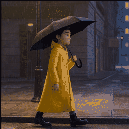
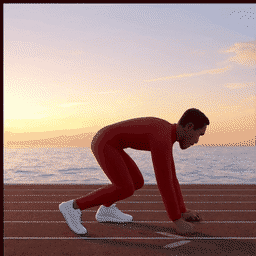
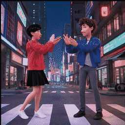
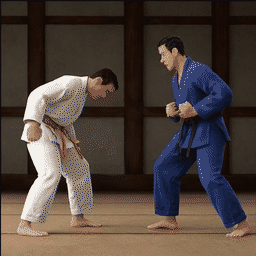
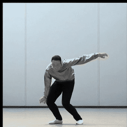

# H3GIF 50-Variant Batch Benchmark

This directory contains the reproducible audit records and visual comparisons from a 50-variant H3-Image → H3GIF test run.

## Matrix

- 10 art styles
- 5 motion profiles: street walk, sprint, partner dance, martial arts, spin/jump
- 5 requested FPS values: 4, 6, 8, 10, 12
- 50 total cases
- 3×3 contact sheet per case
- 9 split frames per case
- 16-frame Ping-pong GIF per case
- 2048×2048 source canvas

## Result

- Technical checks passed: **50/50**
- Average generation time: **50.001 seconds**
- Average GIF size: **4.2 MiB**
- Total GIF size: **209.998 MiB**
- All source sheets: 2048×2048
- All cases: 9 split frames and 16-frame infinite-loop GIFs

## Effective GIF FPS

GIF timing has 10 ms precision, so requested FPS values are quantized:

| Requested | Effective |
|---:|---:|
| 4 | 4.0 |
| 6 | 6.25 |
| 8 | 8.333 |
| 10 | 10.0 |
| 12 | 12.5 |

`effective_fps` is now returned by `H3GIF GIF Export` in v0.3.1-beta.

## Visual Comparisons

- `batch50_all_variants.jpg`: all 50 source contact sheets in one overview
- `batch50_style_sheet.jpg`: one case from each of the 10 styles
- `batch50_motion_sheet.jpg`: one case from each of the 5 motion profiles
- `previews/`: compressed representative GIFs for the five motion profiles

## Motion Preview GIFs

| Motion | Preview |
|---|---|
| Street walk |  |
| Sprint |  |
| Partner dance |  |
| Martial arts |  |
| Spin and jump |  |

## Audit Files

- `batch50_report.md`: human-readable report
- `batch50_report.csv`: all 50 cases with timing, FPS and output paths
- `batch50_audit.json`: machine-readable validation summary
- `batch50_manifest.json`: exact test matrix and seeds
- `batch50_results.json`: ComfyUI prompt IDs and per-case outputs
- `batch50_summary.json`: aggregate success/time metrics

## Media Policy

The 50 full-resolution source sheets, 450 frame PNGs and 50 original GIFs are not committed to Git because they total hundreds of MB. The audit records, comparison sheets and compressed previews are sufficient to review the run and reproduce it with the manifest.

## Quality Notes

- Single-character walking, sprinting and spin/jump cases are generally the most stable.
- Partner dance and martial arts can still produce missing characters, proportional changes or unusual limbs at 3×3 density.
- These are H3-Image generation limitations, not H3GIF splitting or GIF encoding failures.

## Reproduce

Start ComfyUI with the validated H3-Image models, then run:

```bash
python docs/benchmarks/run_50_variants.py
```

Optional environment variables:

```bash
H3GIF_SERVER=http://127.0.0.1:8189
H3GIF_BENCH_OUTPUT=/path/to/result-directory
```

The runner writes incremental progress and skips cases already marked successful in `batch50_results.json`.
